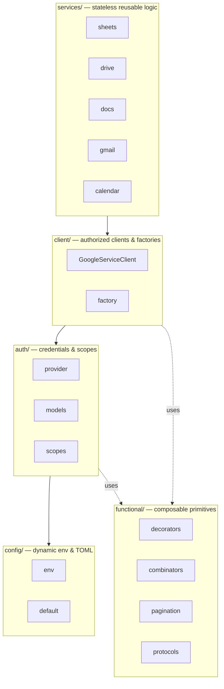
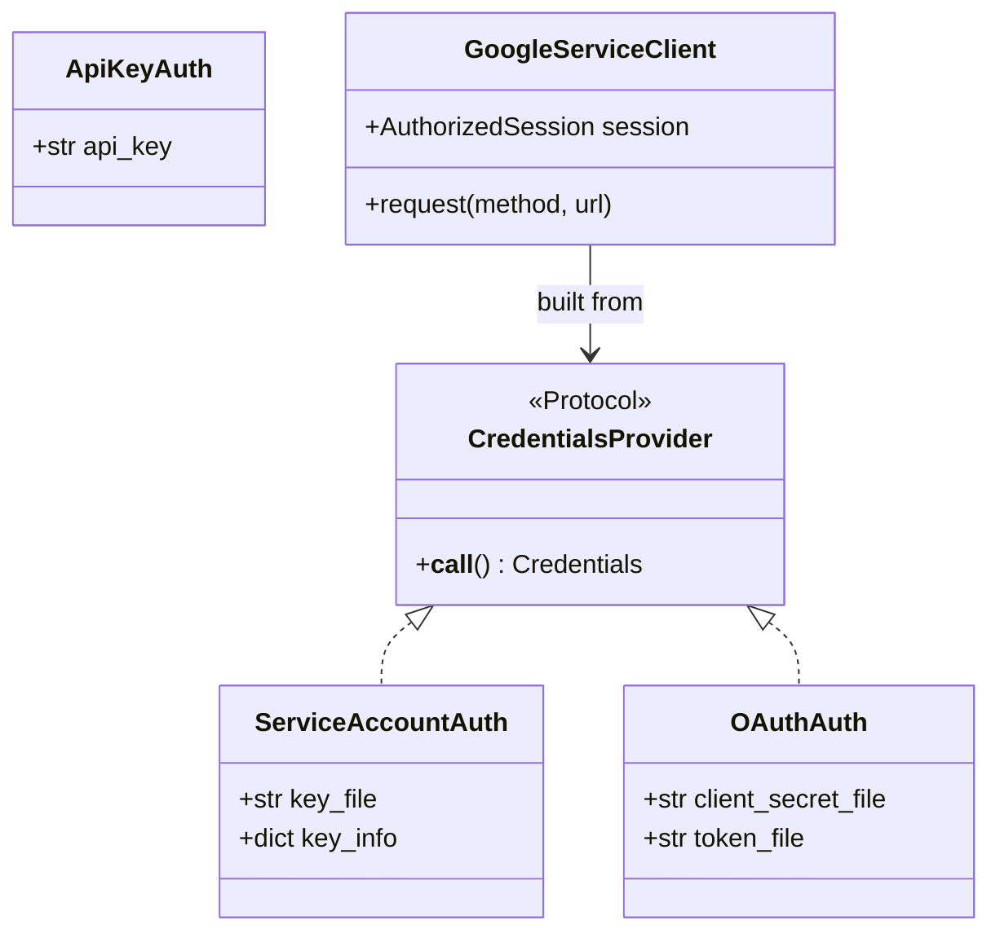
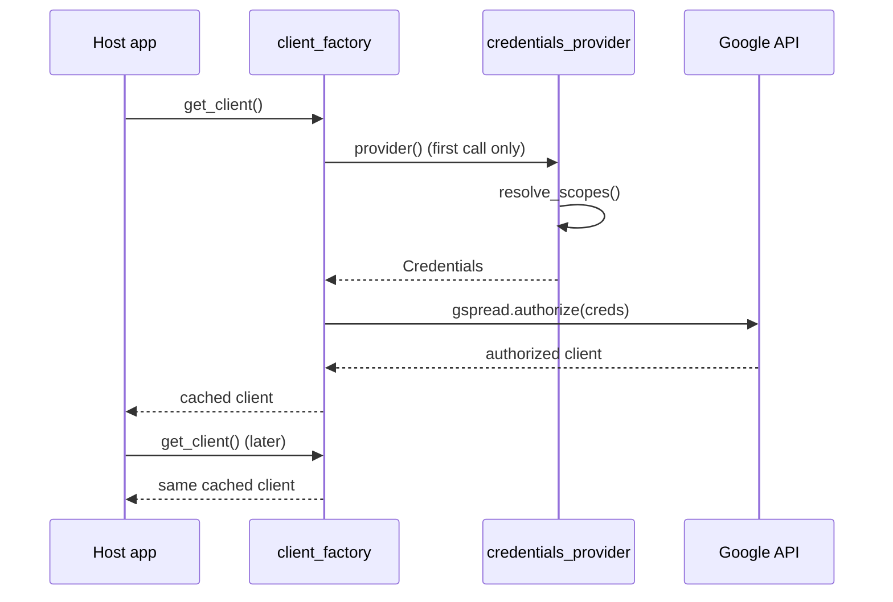

# Architecture

`googlepy` is organized in layers. Higher layers depend only on lower ones, and
every layer is **stateless** — state (caching, persistence) belongs to the
consuming application.

## Layered design



## Core class relationships



## Authentication flow



## Auto-generated class diagram

The diagram below is generated directly from the source with
[`pyreverse`](https://pylint.readthedocs.io/en/latest/pyreverse.html) (ships with
`pylint`), so it never drifts from the code. Regenerate it with:

```bash
python scripts/gen_uml.py
```

--8<-- "docs/diagrams/classes.md"
